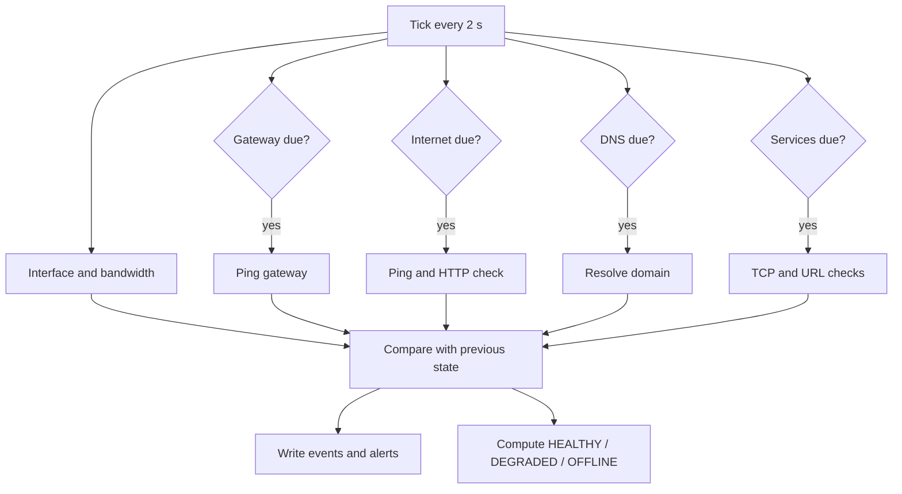

# Monitoring Flow

The engine ticks every 2 seconds. Each check runs only when its interval has passed.

```text
tick (every 2 s)
  |-- interface + local IP + bandwidth   (every tick, 2 s)
  |-- gateway ping                       (every 4 s)
  |-- internet ping + HTTP check         (every 6 s)
  |-- DNS resolution                     (every 10 s)
  |-- TCP services + HTTP URLs           (every 6 s)
  `-- generate events (state changes)    (every tick)
Each check is wrapped in try/except: one failure never stops the others.
```


