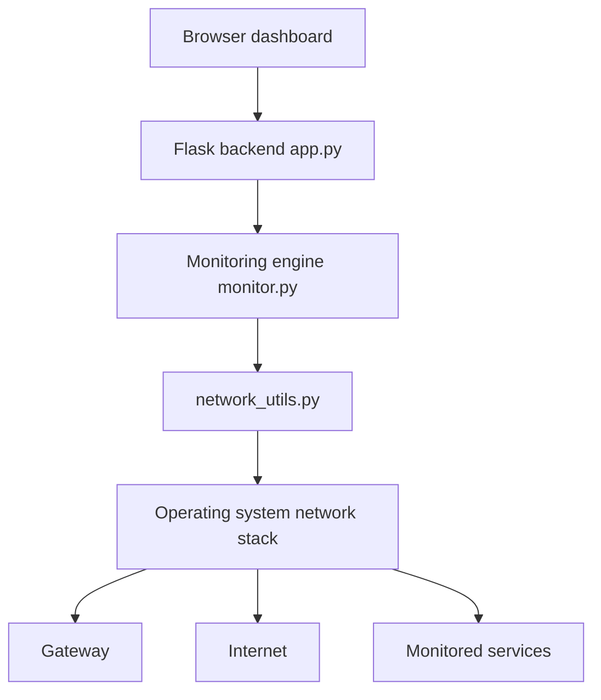

# System Architecture

```text
+--------------------------------------------------------------+
|  Browser: HTML / CSS / JavaScript dashboard (polls 2-5 s)    |
+------------------------------+-------------------------------+
                               | HTTP + JSON (localhost)
+------------------------------v-------------------------------+
|  Flask backend (app.py)  - routes read stored results only   |
+------------------------------+-------------------------------+
                               | function calls (thread-safe)
+------------------------------v-------------------------------+
|  Monitoring engine (monitor.py) - background thread          |
|  interface/bandwidth | gateway | internet | DNS | services    |
+------------------------------+-------------------------------+
                               | helper functions
+------------------------------v-------------------------------+
|  network_utils.py: ping, socket, DNS, HTTP, psutil           |
+------------------------------+-------------------------------+
                               |
+------------------------------v-------------------------------+
|  Operating system network stack                              |
+-----------+------------------+-------------------+-----------+
            |                  |                   |
        Gateway            Internet        Configured services
```


