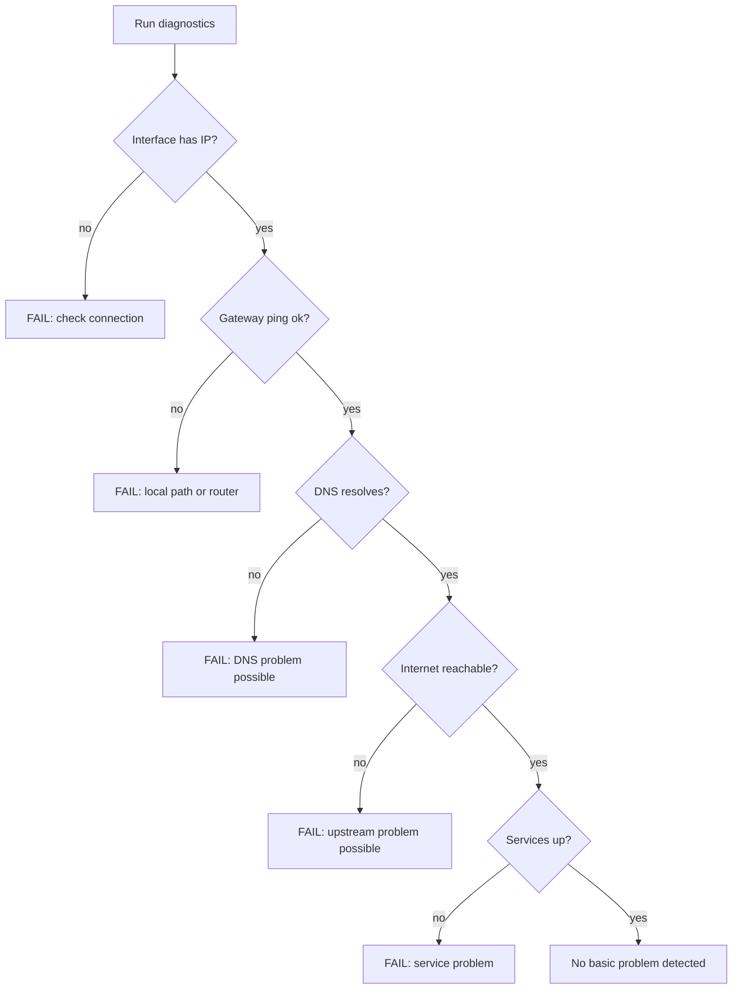

# Troubleshooting Flow

```text
Run Network Diagnostics
  1. Local interface   -> FAIL: check Wi-Fi/Ethernet, adapter
  2. Default gateway   -> not found: set manually
  3. Gateway ping      -> FAIL: local network/router may be unavailable
  4. DNS resolution    -> FAIL: DNS server may be unreachable
  5. Internet check    -> FAIL + gateway OK: possible upstream/WAN problem
  6. Configured services -> FAIL: service stopped, blocked or host down
Result: "No basic connectivity problem detected" or "Possible problem areas: ..."
```


All wording is "possible cause": the tool cannot identify every root cause.
