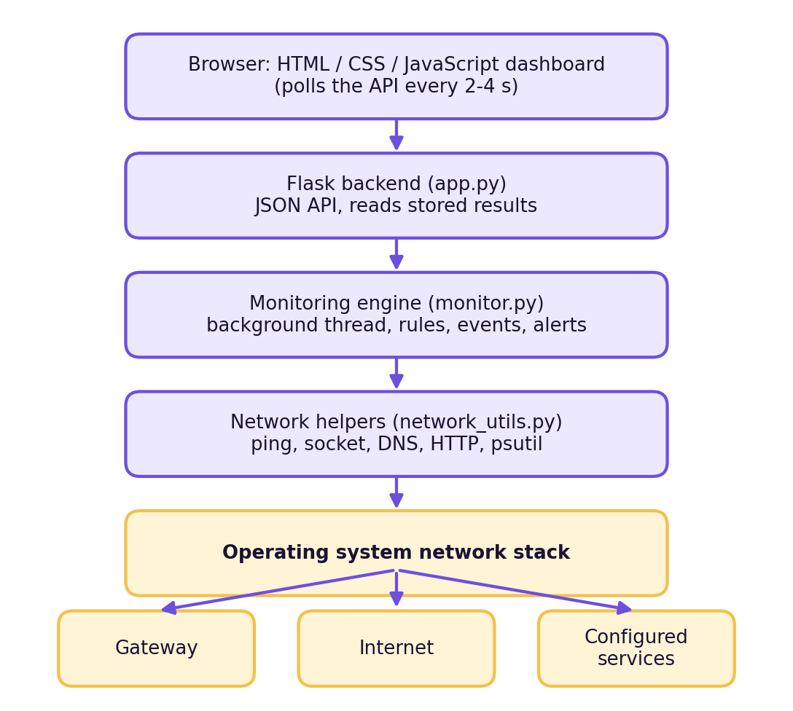
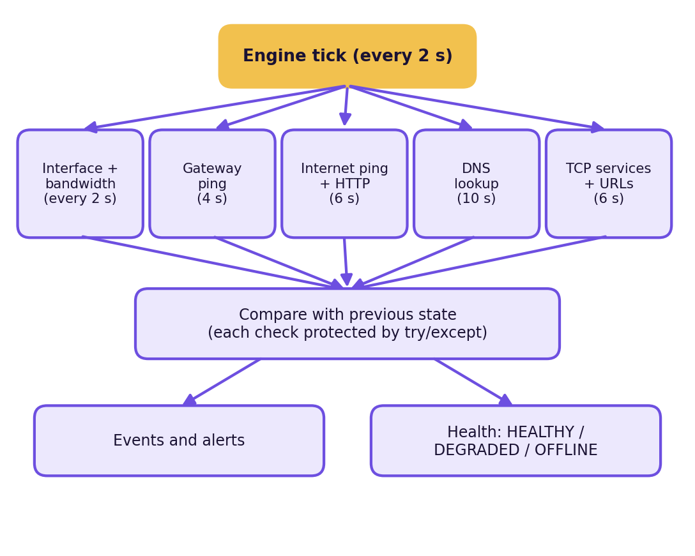
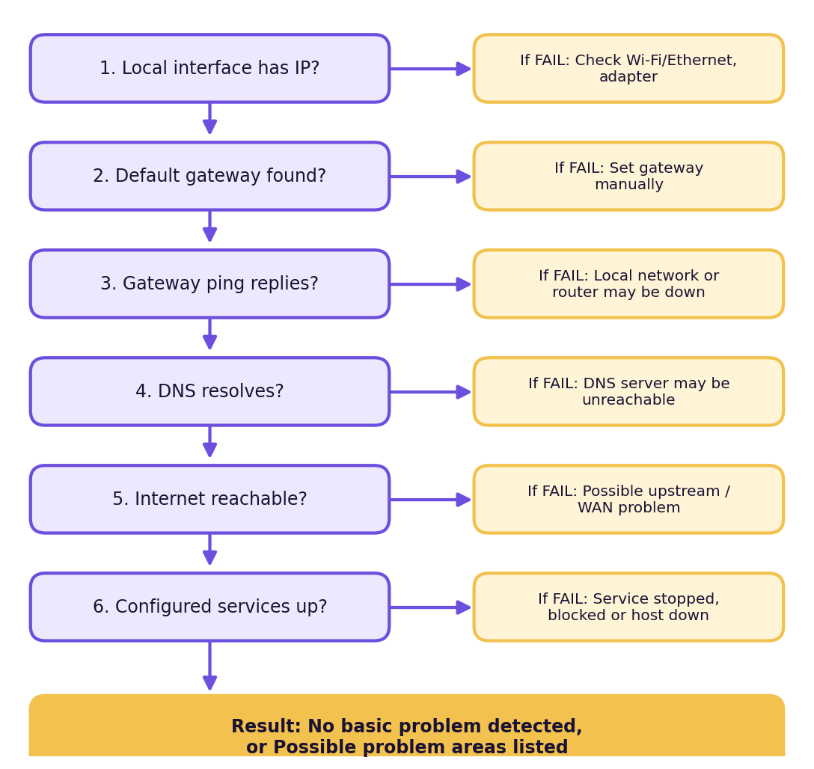

# NetWatch: Real-Time Network Monitoring & Troubleshooting System

Computer Networks Mini Project Report

Submitted by: **AKULA AJAY KUMAR** | Roll Number: [Roll Number] | [Batch / Section]

Department of Computer Science and Engineering, CMR Technical Campus | Academic Year: [Academic Year]

Project Guide: [Name of Project Guide]


# Certificate

This is to certify that the project work entitled **"NetWatch: Real-Time Network Monitoring & Troubleshooting System"** is a bonafide work carried out by **AKULA AJAY KUMAR** (Roll Number: [Roll Number]), a student of B.Tech in Computer Science and Engineering, [Batch / Section], CMR Technical Campus, in partial fulfilment of the requirements for the Computer Networks subject during the academic year [Academic Year].

The work has been carried out under our guidance and the report has not been submitted elsewhere for any other degree or course.

Project Guide: [Name and Signature]  |  Head of Department: [Name and Signature]  |  External Examiner: [Name and Signature]  |  Principal: [Name and Signature]


# Declaration

I, **AKULA AJAY KUMAR**, hereby declare that the project report entitled **"NetWatch: Real-Time Network Monitoring & Troubleshooting System"** is an original work done by me for the Computer Networks subject of the B.Tech Computer Science and Engineering programme at CMR Technical Campus.

The software was designed and tested by me. Results in this report are taken from actual execution of the project. Where I have not yet executed a test, the report says so clearly. I have not copied the project from any other person or source, and the references used are listed at the end of the report.

Place: [Place]

Date: [Date]

**AKULA AJAY KUMAR**

Roll Number: [Roll Number]


# Acknowledgement

I would like to thank my Computer Networks faculty member, [Name of Faculty / Project Guide], for the guidance and encouragement given during this mini project. The classroom lessons on IP addressing, ICMP, DNS and TCP helped me understand what the software has to measure.

I thank the Head of the Department of Computer Science and Engineering, [Name of HOD], and the Principal, [Name of Principal], of CMR Technical Campus for providing the lab facilities and a good academic environment.

I also thank my friends and classmates who tested the dashboard and gave suggestions, and my family for their support.

**AKULA AJAY KUMAR**

# Abstract

Small organisations such as college labs, hostels, small offices and homes often need a simple way to find basic network problems. When a user says "the internet is slow", an administrator must find out whether the cause is the local connection, the router, DNS, the internet link, high delay, packet loss or one particular server. Large monitoring products can answer these questions, but they are heavy to install and difficult for beginners.

NetWatch is a lightweight, local, web-based network monitoring and troubleshooting tool written in Python. A background monitoring engine continuously collects real measurements from the operating system and the network: interface statistics (psutil), default gateway reachability, internet reachability using ICMP ping and a small HTTPS request, DNS resolution time, latency, packet loss, bandwidth calculated from byte counters, and the state of TCP services and URLs configured by the user. A Flask backend serves these results as JSON, and an HTML, CSS and JavaScript dashboard refreshes every few seconds with live cards, graphs, alerts and an event log. A Network Troubleshooter runs six safe tests and reports a *possible cause* and suggested steps.

No value in the dashboard is random or simulated; when a value cannot be measured it is shown as "Unavailable". The tool performs no port scanning, packet sniffing or device discovery and needs no paid service, API key or database. The project demonstrates concepts of the TCP/IP model, ICMP, DNS, TCP ports, HTTP, latency, packet loss and bandwidth through a practical application.

# Keywords

Network monitoring, Troubleshooting, Latency, Packet loss, ICMP ping, DNS, Default gateway, TCP port, HTTP, Bandwidth, Flask, psutil, Python, Real-time dashboard


# Table of Contents

(Generated in the Word report.)


# Chapter 1: Introduction

## 1.1 Introduction

Computer networks connect our laptops, phones, servers and printers to each other and to the internet. We depend on them for classes, work and entertainment. When a network fails or becomes slow, people lose time. The first question is always the same: *where is the problem?*

NetWatch is a small tool that helps answer that question. It runs on one computer, performs several simple tests against the real network, and shows the results in a live web dashboard. It is meant for people who are not network experts: a lab assistant, a hostel network volunteer, a small shop owner or a student.

## 1.2 Background

A network connection from a computer to a website passes through several parts. The computer needs a working network interface with an IP address. It sends packets to the default gateway, usually the router. The router forwards them to the internet service provider. Before any website can be opened, a domain name such as example.com must be converted into an IP address by DNS. Finally the web server must be running and reachable on its TCP port.

If any one part fails, the user sees the same symptom: "the internet is not working". Network administrators therefore test each part one by one, normally by typing commands such as `ipconfig`, `ping` and `nslookup`. This is slow and needs knowledge. Monitoring software does the same tests automatically and repeatedly, and records when things change.

Existing professional tools such as Nagios, Zabbix, PRTG or SolarWinds do this on a large scale. They are powerful, but they need servers, configuration, and often licences. NetWatch takes the same basic idea and reduces it to a size that a B.Tech student can build, run and explain.

## 1.3 Problem Statement

Small organisations lack a simple, free and easy-to-understand tool that continuously checks basic network health and helps identify whether a problem lies in the local connection, the gateway, DNS, the internet, latency, packet loss or a particular service.

Reporting "internet is slow" is not enough for diagnosis. The administrator needs real numbers (latency, loss, reachability) and a history of when the condition started.

## 1.4 Motivation

- Network problems are common in labs and hostels, and they are usually reported in vague words.
- Command-line tools give one answer at a time and no history. Students and small-office staff often do not know them.
- Learning Computer Networks is easier when the concepts are used to build something real.
- A practical monitoring tool can be demonstrated live in front of faculty: a changing condition (for example a stopped service) is detected on the screen within seconds.
## 1.5 Objectives

1. Continuously monitor network connectivity of the local computer.
2. Detect and ping the default gateway without hard-coding any IP address.
3. Check internet reachability with a lightweight ICMP and HTTPS test.
4. Check DNS by performing real name resolution and timing it.
5. Measure latency and calculate packet loss from controlled ping tests.
6. Calculate download and upload rate from interface byte counters.
7. Monitor user-configured TCP services and HTTP URLs.
8. Generate alerts and keep a limited event history (last 100 events).
9. Provide a Network Troubleshooter that gives possible causes and suggested steps.
10. Present all results in a responsive real-time dashboard that runs on Windows.
## 1.6 Scope

**In scope:** monitoring of the local computer's network path; a configurable list of up to 10 TCP services and 10 URLs; threshold-based alerts; in-memory history of the last 15 minutes; a local web dashboard; Windows support through batch files (the code also runs on Linux and macOS).

**Out of scope:** discovering or scanning other devices; packet capture; SNMP; storing long-term history in a database; sending email or SMS alerts; user login and roles; monitoring many computers from one place. These are listed as future scope.

## 1.7 Existing System

Today a small administrator uses one of these approaches:

1. **Manual commands:** `ipconfig`, `ping`, `tracert`, `nslookup`, `netstat`.
2. **Online speed tests:** websites that measure speed to a distant server.
3. **Router web page:** shows connected devices and basic statistics, different for every router brand.
4. **Enterprise monitoring tools:** Nagios, Zabbix, PRTG, SolarWinds and similar products.
## 1.8 Limitations of the Existing System

| Approach | Limitation |
|---|---|
| Manual commands | Needs knowledge; one test at a time; no history; no alerts |
| Online speed tests | Measure speed to one remote server only; say nothing about the gateway, DNS or local services |
| Router web page | Different for each router; often hides latency and packet loss; no alerts |
| Enterprise tools | Complex installation, servers, learning time; some are paid; too heavy for a lab or home |

## 1.9 Proposed System

NetWatch combines the useful manual tests into one automatic application:

- It tests each part of the connection path separately (interface, gateway, DNS, internet, services).
- It repeats the tests every few seconds, with different timers for different checks.
- It shows live graphs and an event history, so the administrator can see *when* a problem started and what the network looked like at that time.
- It decides the overall status (ONLINE, DEGRADED, OFFLINE) using documented rules, not a made-up score.
- It starts with two commands (`install.bat`, `run_app.bat`) and needs no cloud service.
## 1.10 Advantages

- Free and open: Python, Flask and psutil only.
- Real measurements; unavailable values are shown as "Unavailable".
- Easy to understand and explain in a viva.
- Local only: data stays on the computer.
- Safe: no scanning, sniffing or intrusive testing.
- Works as a live demonstration, even without internet, using the local test service.
## 1.11 Real-World Use Case

*A college computer lab.* Students complain that the internet is slow. The lab assistant opens NetWatch on the teacher's computer. The dashboard shows Gateway REACHABLE with 2 ms latency, Internet ONLINE, but DNS FAILED and the event log says "DNS check failed" three minutes ago. The assistant now knows to check the DNS server setting instead of replacing cables. Without this information the assistant might have restarted every switch in the lab.

*A hostel or home network.* The user sees packet loss rising while the Wi-Fi interface still shows UP. This points towards Wi-Fi signal or router overload rather than the internet provider.

*A small office.* The office application server runs on port 5000 on a local machine. NetWatch monitors that host and port and raises "Monitored service unavailable" the moment the server stops.

# Chapter 2: System Requirements

## 2.1 Hardware Requirements

| Item | Minimum | Recommended |
|---|---|---|
| Processor | Dual-core 1.5 GHz | Quad-core 2 GHz or better |
| RAM | 2 GB | 4 GB or more (the development laptop has 8 GB) |
| Storage | 100 MB free | 500 MB free (virtual environment included) |
| Network | One Wi-Fi or Ethernet adapter | Wi-Fi or Ethernet with internet access |
| Display | 1280 x 720 | 1920 x 1080 (mobile screens also supported) |

NetWatch uses very little CPU: the checks are short and are spread over time. Memory is bounded because all history uses fixed-size queues.

## 2.2 Software Requirements

| Software | Version / Note |
|---|---|
| Operating system | Windows 10 or 11 (also runs on Linux and macOS) |
| Python | 3.9 or newer |
| Flask | 2.3 or newer |
| psutil | 5.9 or newer |
| Web browser | Chrome, Edge or Firefox (current versions) |
| Code editor (optional) | Visual Studio Code |

The `ping` and `route`/`ipconfig` commands that come with Windows are used by the program. No administrator rights are needed for normal operation.

## 2.3 Technology Stack

| Layer | Technology | Why it was chosen |
|---|---|---|
| Backend language | Python 3 | Simple, strong networking library, easy to explain |
| Web framework | Flask | Small and easy; JSON API in few lines |
| Network access | socket, subprocess, urllib, ipaddress | Standard library, no extra install |
| System statistics | psutil | Real interface counters and status on all platforms |
| Concurrency | threading | One background monitoring thread is enough |
| Frontend | HTML, CSS, JavaScript | No framework; canvas charts need no internet library |
| Testing | unittest | Part of Python; no extra package |
| Packaging | Batch files (install.bat, run_app.bat) | One-step setup on Windows |

No paid API, API key, cloud service or database is used.

# Chapter 3: Network Monitoring Concepts

This chapter explains the networking ideas that NetWatch measures. Each idea is linked to the part of the project that uses it.

## 3.1 What is Network Monitoring?

Network monitoring is the continuous observation of a network to check that it is available and performing well, and to raise a warning when it is not. The main measurements are availability (is it reachable?), performance (how fast?) and reliability (does it lose data?).

## 3.2 IP Addressing

Every device on an IP network has an IP address. IPv4 addresses are 32 bits long and are written as four numbers, for example 192.168.1.10. Part of the address identifies the network and part identifies the host; the **subnet mask** (for example 255.255.255.0) tells which part is which. Addresses in the ranges 10.0.0.0/8, 172.16.0.0/12 and 192.168.0.0/16 are *private* and are used inside homes, labs and offices. IPv6 addresses are 128 bits long and solve the shortage of IPv4 addresses.

*In NetWatch:* the Local IP card shows the IPv4 address of the interface used to reach the network, and the Network Information page lists IPv6 addresses if available. The program validates every IP address entered by the user with Python's `ipaddress` module.

## 3.3 TCP/IP Model

The TCP/IP model has four layers:

| Layer | Purpose | Examples used in NetWatch |
|---|---|---|
| Application | Services used by programs | HTTP/HTTPS, DNS |
| Transport | End-to-end delivery between ports | TCP connection to a service |
| Internet (Network) | Addressing and routing of packets | IP, ICMP (ping) |
| Network Access (Link) | Sending frames on the local medium | Wi-Fi/Ethernet interface, MAC address |

NetWatch tests one thing at each layer. That is why its results can narrow down where a problem is: the interface (link), the gateway ping (network), the TCP service check (transport) and the DNS and HTTP checks (application).

## 3.4 ICMP

The Internet Control Message Protocol carries control and error messages between devices. The `ping` tool sends an ICMP **echo request** and waits for an ICMP **echo reply**. The time between them is the **round-trip time**. No reply may mean the host is down, the path is broken, or a firewall is blocking ICMP.

*In NetWatch:* the gateway and internet latency come from the operating system's ping command. NetWatch counts a reply only when the output contains a TTL value, so "Destination host unreachable" lines on Windows are not counted as success. If the ping command is not available, NetWatch falls back to timing a TCP connection and labels the method as such.

## 3.5 DNS

The Domain Name System converts names (example.com) into IP addresses. Without DNS, the user can reach a server by IP address but not by name. A DNS lookup normally goes to the DNS server given by the router or the internet provider, which may ask other servers. DNS failures are a very common cause of "internet is not working" while the link itself is fine.

*In NetWatch:* the DNS card resolves the configured domain with `socket.getaddrinfo`, shows the first IP address and measures the time. The lookup runs in a worker thread with a timeout so a slow DNS server cannot freeze the monitor.

## 3.6 TCP Ports

A TCP port number (0 to 65535) identifies a service on a host: 80 for HTTP, 443 for HTTPS, 22 for SSH, 5000 for many development servers. A TCP connection starts with a three-way handshake (SYN, SYN-ACK, ACK). If the port is closed, the host answers with a reset and the connection is *refused*; if a firewall drops the packet, the attempt *times out*.

*In NetWatch:* the service monitor makes **one** TCP connection attempt to each configured host and port and reports UP, or DOWN with the reason (refused, timeout, name not resolved). It never scans ranges of ports.

## 3.7 HTTP and HTTPS

HTTP is the application protocol of the web. A client sends a request and the server replies with a status code: 200 means OK, 404 not found, 500 internal server error. HTTPS is HTTP protected by TLS encryption.

*In NetWatch:* the URL monitor sends a small GET request asking for the first 1 KB only, reads at most 1024 bytes, and records the status code and response time. Codes of 400 and above are treated as DOWN. Timeouts, DNS failures and connection errors are handled separately.

## 3.8 Network Latency

Latency is the delay between sending a packet and receiving the reply, measured in milliseconds. It depends on distance, congestion, Wi-Fi quality and the load on devices. High latency makes web pages and video calls feel slow even if the link has plenty of bandwidth. NetWatch shows the current, average, minimum and maximum latency of the selected time window; the gap between minimum and maximum gives a rough idea of jitter.

## 3.9 Packet Loss

Packet loss is the percentage of packets that do not receive a reply:

`Packet loss % = (packets sent - packets received) / packets sent x 100`

Even small loss (a few percent) hurts calls and games, and TCP must retransmit lost data, which slows downloads. NetWatch sends three pings in every cycle and plots the loss for each cycle. The user sets a threshold (default 10%); above it, an alert is raised.

## 3.10 Bandwidth and Throughput

*Bandwidth* is the maximum rate of a link. *Throughput* is the rate actually achieved at a moment. NetWatch measures throughput through one interface by reading its byte counters from the operating system twice:

`Speed (Mbps) = (change in bytes x 8) / change in seconds / 1,000,000`

This is the traffic of the whole computer on that interface now; it is **not** the maximum internet speed, and the dashboard says so.

## 3.11 Network Interfaces

A network interface is the hardware or virtual adapter that connects the computer to a network: Wi-Fi, Ethernet, loopback, or virtual adapters created by VPN or virtual machine software. A computer often has several. The program therefore does not assume the first interface is the real one: it selects the interface that owns the local IP address and lets the user choose another one.

## 3.12 Client-Server Architecture

In the client-server model a server waits for requests and clients send them. NetWatch uses this model twice. The browser (client) requests data from the Flask server (server) on the same computer. And NetWatch itself acts as a client when it connects to the services and web servers it monitors.

# Chapter 4: System Design

## 4.1 System Architecture



The architecture has five layers, from top to bottom:

1. **Browser dashboard** (HTML, CSS, JavaScript) shows cards, graphs, alerts and the event log, and asks the server for new data every 2 to 4 seconds.
2. **Flask backend** (`app.py`) provides JSON endpoints. It only reads stored results.
3. **Monitoring engine** (`monitor.py`) runs in a background thread and decides what to check and when.
4. **Helper functions** (`network_utils.py`) perform the real pings, socket connections, DNS lookups, HTTP requests and psutil reads.
5. **Operating system network stack**, which reaches the gateway, the internet and the configured services.
Polling was chosen instead of WebSockets because it is simpler, easier to debug and enough for a 2 to 5 second refresh.

## 4.2 Monitoring Architecture

The engine ticks every 2 seconds. On each tick it runs only the checks whose interval has passed, so slow checks do not delay fast ones, and the network is not flooded:

| Check | Interval | Network cost per run |
|---|---|---|
| Interface statistics and bandwidth | 2 s | None (local counters) |
| Gateway ping | 4 s | 3 ICMP packets |
| Internet ping + HTTPS request | 6 s | 3 ICMP packets + one 1 KB request |
| DNS resolution | 10 s | One lookup |
| TCP services and URLs | 6 s | One connection / request per item |



Every check is wrapped in a `try/except` block. If a check raises an unexpected error, an event is written and the other checks continue. This satisfies the requirement that one failed test must not crash the application.

## 4.3 Module Design

| Module | File | Responsibility |
|---|---|---|
| Web server | `app.py` | Flask routes, JSON errors, startup |
| Monitoring engine | `monitor.py` | Scheduling, state, events, alerts, health rules, diagnostics |
| Network helpers | `network_utils.py` | Ping, DNS, TCP, HTTP, gateway, interfaces, calculations |
| Configuration | `config.py` | Defaults, limits, validation of user input |
| Frontend | `templates/index.html`, `static/style.css`, `static/app.js` | Dashboard, charts, configuration form |
| Demo service | `test_service.py` | Local service on 127.0.0.1:5001 for demonstration |
| Tests | `tests/` | 56 unit tests and manual test cases |

The `MonitoringEngine` class contains these main methods: `get_network_interfaces()`, `get_local_ip()`, `get_gateway()`, `ping_gateway()`, `check_internet()`, `check_dns()`, `check_services()`, `calculate_bandwidth()`, `generate_events()` and `run_diagnostics()`.

## 4.4 Data Storage

No database is used. The engine keeps data in memory using bounded queues (`collections.deque`):

| Data | Limit |
|---|---|
| Events | Last 100 |
| Ping history (latency and loss) | 200 samples, about 15 minutes |
| Bandwidth history | 450 samples, about 15 minutes |
| Services / URLs | Up to 10 each |

Old items are dropped automatically, so memory does not grow without limit. The browser also redraws charts from the server's bounded data. The price of this design is that history is lost when the program stops; a database is listed as future scope.

## 4.4.1 Backend API

| Endpoint | Method | Returns |
|---|---|---|
| `/api/status` | GET | All current results: status, cards, health, alerts, services |
| `/api/network-info` | GET | Hostname, OS, IP addresses, gateway, interfaces |
| `/api/interfaces` | GET | Interface list with counters |
| `/api/latency?window=1\|5\|15` | GET | Latency, loss and bandwidth history for the window |
| `/api/dns` | GET | Latest DNS result |
| `/api/services` | GET | Latest TCP service and URL results |
| `/api/http-check` | GET | Latest URL results |
| `/api/diagnostics` | GET | Runs the troubleshooter and returns its steps |
| `/api/events` | GET, DELETE | Event list; DELETE clears the log |
| `/api/config` | GET, POST | Current settings; validated update |

Errors are returned as short JSON messages such as `{"error": "Not found"}`. Python stack traces are never sent to the browser; they stay in the server console.

# Chapter 5: Module Description

## 5.1 Dashboard

The dashboard is one page with four tabs: Dashboard, Network Troubleshooter, Network Information and Configuration. The design uses a dark background, deep lavender accents, gold highlights and glass-like cards, and it re-arranges into one column on a phone.

The top bar shows the project name, the subtitle and the **NETWORK STATUS** indicator (ONLINE, DEGRADED, OFFLINE, or CHECKING during the first seconds). Eight cards show Internet, Gateway, DNS, Packet Loss, Interface, Local IP, Download and Upload. Below them are the live latency graph with its statistics, the Network Health list, the bandwidth and packet loss graphs, the alert list, service and URL monitors, interface statistics and the event log.

The JavaScript file never builds HTML from server data. All text is inserted with `textContent`, so a service name typed by a user cannot inject script code into the page.

## 5.2 Gateway Monitoring

The default gateway is the router that connects the local network to other networks. NetWatch finds it without hard-coding any address:

- **Windows:** parses the output of `route print -4` and takes the `0.0.0.0` route with the lowest metric; if that fails it parses `ipconfig`.
- **Linux:** reads `/proc/net/route`, then `ip route` as a fallback. **macOS:** `route -n get default`.
- If detection fails, the card shows **Unavailable** and the user may enter the gateway IP manually in Configuration.
The gateway is pinged with three echo requests every 4 seconds. The card shows REACHABLE with the average latency, or UNREACHABLE. Some routers do not answer ping; the README and the Limitations chapter explain this.

## 5.3 Internet Monitoring

The internet check combines two tests so that blocking of one protocol does not give a wrong result: an ICMP ping to a safe public address (default 1.1.1.1) and a tiny HTTPS request (default https://example.com, only the first 1 KB is read). The internet is ONLINE if either test succeeds and OFFLINE if both fail. The latency and packet loss shown on the dashboard come from the ping. If ping cannot run, TCP connection timing to port 443 is used and the card says `tcp-443`.

The program reasons as follows and states it plainly in the dashboard: *gateway reachable but internet unavailable* can indicate an upstream, WAN or DNS problem; *gateway unreachable* usually points to a local network path problem. These are hints, not proof.

## 5.4 DNS Monitoring

Every 10 seconds NetWatch resolves the configured domain (default example.com) using the system resolver. The card shows AVAILABLE with the resolved IP and the response time in milliseconds, or FAILED with the reason ("Name could not be resolved" or "DNS timeout"). The test domain can be changed on the Configuration page and is validated as a proper hostname.

## 5.5 Service Monitoring

The administrator adds a name, host and port, for example *Web Server, 192.168.1.10, 80*. Every 6 seconds NetWatch makes one TCP connection attempt (timeout 2 seconds) and shows UP with the connect time, or DOWN with the reason: connection refused, timeout, or host name not resolved.

This is deliberately **not** a port scanner: only the explicit host and port pairs entered by the user are contacted, one attempt each, and at most ten may be configured.

HTTP URL monitoring works the same way for web addresses. It shows UP or DOWN, the HTTP status code and the response time, and handles timeout, DNS failure, connection error and HTTP error codes.

## 5.6 Interface Monitoring

The interface module uses psutil to list real interfaces with status (UP or DOWN), IPv4 address, MAC address, bytes sent and received, packets sent and received, and error counts. The dashboard card shows the selected interface, and the Interface Statistics panel shows its counters in readable units (KB, MB, GB). A drop-down lets the user choose which interface to monitor; the default **Auto** chooses the interface that owns the local IP address, because the first interface in the list is often a virtual adapter.

If psutil is not installed, the application still starts, the interface values show "Unavailable", and a message tells the user to run `pip install psutil`.

## 5.7 Bandwidth Monitoring

The engine reads the interface byte counters every 2 seconds and calculates the difference from the previous reading:

`download Mbps = (received_now - received_before) x 8 / seconds / 1,000,000`

and the same for upload. If a counter goes backwards (for example after the adapter restarts) the sample is discarded and shown as Unavailable instead of a wrong number. The dashboard states that this is measured traffic and not the maximum speed of the internet connection.

## 5.8 Alert System

Alerts are calculated from the latest real results. An alert is active only while its condition is true.

| Condition | Alert text |
|---|---|
| Gateway ping fails | Gateway unreachable |
| Internet ping and HTTP both fail | Internet connectivity lost |
| DNS lookup fails | DNS resolution failing |
| Average latency above threshold (default 200 ms) | High latency detected |
| Packet loss above threshold (default 10%) | Packet loss detected |
| TCP service or URL down | Monitored service unavailable |

## 5.9 Event Log

The event log records *changes*, so it stays readable: for example "Gateway reachable", "Internet connectivity lost", "SERVICE DOWN: Demo Test Service (127.0.0.1:5001)", "SERVICE RESTORED", "Latency increased above threshold" and "Network DEGRADED". Each line has a time stamp. Only the last 100 events are kept, and the **Clear Logs** button empties the list.

## 5.10 Troubleshooting Engine

The Network Troubleshooter runs when the user presses **Run Network Diagnostics**. It performs the tests in a fixed order:

1. Local interface status (does an interface have an IP address?)
2. Default gateway detection
3. Gateway ping
4. DNS resolution
5. Internet connectivity
6. Configured service checks
Each step is shown as PASS, FAIL, SKIPPED or UNAVAILABLE. For a failed step the page shows a **Possible cause** and a **Suggested troubleshooting step**. For example, a failed gateway ping suggests "Local network/router connectivity may be unavailable" and "Check Wi-Fi/Ethernet connection, check router status, verify network adapter". If all tests pass the result is "No basic connectivity problem detected." The wording avoids claiming to know the exact root cause, because six simple tests cannot find every fault.



## 5.11 Network Information and Configuration Pages

The Network Information page shows the hostname, operating system, IPv4 and IPv6 addresses, default gateway, selected interface, MAC address, the DNS test domain and a list of interfaces. Sensitive details such as Wi-Fi passwords are never read.

The Configuration page lets the user set: gateway mode (Auto Detect or Manual IP), DNS test domain, internet ping host and URL, latency and packet loss thresholds, the service list and the URL list. Every field is validated on the server. Invalid input is refused with a clear message and the old settings are kept.

# Chapter 6: Algorithms

## 6.1 Main Monitoring Loop

```text
START engine thread
LOOP forever:
    run interface + local IP + bandwidth check
    IF gateway interval passed:   ping gateway
    IF internet interval passed:  ping internet host and send HTTP request
    IF DNS interval passed:       resolve test domain
    IF services interval passed:  check each TCP service and URL
    compare new results with previous state -> write events
    wait 2 seconds
```

Each line inside the loop is protected by exception handling.

## 6.2 Packet Loss Calculation

```text
INPUT: sent, received
IF sent <= 0: RETURN Unavailable
received = MIN(received, sent)
RETURN (sent - received) * 100 / sent
```

Example: 3 pings sent, 2 replies received: loss = (3 - 2) x 100 / 3 = 33.3%.

## 6.3 Bandwidth Calculation

```text
INPUT: bytes_before, bytes_now, seconds
IF seconds <= 0 OR bytes_now < bytes_before: RETURN Unavailable
RETURN (bytes_now - bytes_before) * 8 / seconds / 1,000,000
```

Example: 250,000 bytes in 1 second = 2.0 Mbps.

## 6.4 Ping Result Parsing

```text
FOR each line in ping output:
    IF line contains "TTL=" (a real reply):
        count one received reply
        read the number after "time=" or "time<" (milliseconds)
latency = average of the times; loss = see 6.2
```

Using the TTL field avoids counting Windows messages such as "Destination host unreachable" as replies.

## 6.5 Network Health Decision

```text
IF no local IP:                                     OFFLINE
ELSE IF internet failing AND gateway not reachable: OFFLINE
ELSE IF any of: internet failing, gateway failing, DNS failing,
        latency > threshold, packet loss > threshold,
        any service/URL down:                       DEGRADED
ELSE:                                               HEALTHY
```

No arbitrary numeric score is used. The decision is documented so that it can be explained and tested.

## 6.6 Event Generation

For each tracked condition (gateway, internet, DNS, latency, loss, each service and URL) the engine stores whether it was OK in the previous cycle. An event is written only when the value changes, or for a problem seen the first time. This prevents the log from filling with repeated messages.

# Chapter 7: Implementation

## 7.1 Project Structure

```text
netwatch-network-monitor/
  app.py            Flask server and API routes
  monitor.py        MonitoringEngine, rules, diagnostics
  network_utils.py  ping, DNS, TCP, HTTP, gateway, interfaces
  config.py         settings, limits, validation
  test_service.py   demo service on 127.0.0.1:5001
  requirements.txt  Flask, psutil
  install.bat / run_app.bat
  templates/index.html
  static/style.css, static/app.js
  tests/            unit tests and test_cases.md
  docs/             documentation, script, viva, checklist, results
  diagrams/         architecture and flow diagrams
```

## 7.2 Key Code: Ping

The function below runs the operating system's ping with a fixed argument list. The host is validated first, so text such as `8.8.8.8; del *` is rejected and can never reach a shell.

```text
def ping(host, count=None, timeout=None):
    """Send a few ICMP echo requests using the OS ping command.

    Returns {"ok", "sent", "received", "loss_pct", "avg_ms", "min_ms", "max_ms",
    "method", "error"}. Falls back to TCP connect timing (port 443) if the ping
    command is missing or blocked from running.
    """
    count = count or config.PING_COUNT
    timeout = timeout or config.PING_TIMEOUT
    result = {"ok": False, "sent": count, "received": 0, "loss_pct": None,
              "avg_ms": None, "min_ms": None, "max_ms": None, "rtts": [],
              "method": "icmp", "error": None}
    if not config.is_valid_host(host):
        result["error"] = "Invalid host"
        return result
    system = platform.system()
    if system == "Windows":
        cmd = ["ping", "-n", str(count), "-w", str(int(timeout * 1000)), host]
    elif system == "Darwin":
        cmd = ["ping", "-c", str(count), "-W", str(int(timeout * 1000)), host]
    else:
        cmd = ["ping", "-c", str(count), "-W", str(int(timeout)), "-i", "0.3", host]
    out = _run(cmd, timeout * count + 6)
    if out is None:
        return _tcp_ping_fallback(host, count, result, "ping command unavailable")
    parsed = parse_ping_output(out, count)
    if parsed["received"] == 0 and re.search(
            r"could not find host|unknown host|name or service not known|"
            r"temporary failure in name resolution|cannot resolve", out, flags=re.I):
        result["error"] = "Host name could not be resolved"
        result["loss_pct"] = 100.0
        return result
    result.update(parsed)
    result["loss_pct"] = calculate_packet_loss(count, parsed["received"])
    if parsed["rtts"]:
        r = parsed["rtts"]
        result.update(avg_ms=round(sum(r) / len(r), 2), min_ms=round(min(r), 2),
                      max_ms=round(max(r), 2))
    result["ok"] = parsed["received"] > 0
    if not result["ok"]:
        result["error"] = "No reply"
    return result
```

## 7.3 Key Code: Gateway Detection (Windows)

This function reads the Windows routing table text and picks the default route with the smallest metric.

```text
def parse_route_print(text):
    """Parse Windows `route print -4` output. Returns gateway IP or None."""
    best = None
    for line in text.splitlines():
        parts = line.split()
        if len(parts) >= 5 and parts[0] == "0.0.0.0" and parts[1] == "0.0.0.0":
            gw = parts[2]
            if config.is_valid_ip(gw) and gw != "0.0.0.0":
                try:
                    metric = int(parts[4])
                except ValueError:
                    metric = 9999
                if best is None or metric < best[0]:
                    best = (metric, gw)
    return best[1] if best else None
```

## 7.4 Key Code: Calculations

```text
def calculate_packet_loss(sent, received):
    """Packet loss percentage = (sent - received) / sent * 100. None if sent is 0."""
    try:
        sent, received = int(sent), int(received)
    except (TypeError, ValueError):
        return None
    if sent <= 0 or received < 0:
        return None
    received = min(received, sent)
    return round((sent - received) * 100.0 / sent, 1)
```

```text
def calculate_bandwidth(prev_bytes, curr_bytes, seconds):
    """Rate in Mbps = (change in bytes * 8) / seconds / 1,000,000.

    Returns None when the counters went backwards (counter reset) or the time
    difference is not positive.
    """
    try:
        delta = curr_bytes - prev_bytes
        if seconds <= 0 or delta < 0:
            return None
        return round(delta * 8.0 / seconds / 1_000_000, 3)
    except TypeError:
        return None
```

## 7.5 Key Code: TCP Service Check

```text
def tcp_check(host, port, timeout=None):
    timeout = timeout or config.TCP_TIMEOUT
    res = {"up": False, "host": host, "port": port, "response_ms": None, "error": None}
    try:
        port = int(port)
        if not (1 <= port <= 65535) or not config.is_valid_host(host):
            raise ValueError
    except (TypeError, ValueError):
        res["error"] = "Invalid host or port"
        return res
    start = time.perf_counter()
    s = None
    try:
        s = socket.create_connection((host, port), timeout=timeout)
        res.update(up=True, response_ms=round((time.perf_counter() - start) * 1000, 1))
    except socket.timeout:
        res["error"] = "Timeout"
    except ConnectionRefusedError:
        res["error"] = "Connection refused"
    except socket.gaierror:
        res["error"] = "Host name could not be resolved"
    except OSError as exc:
        res["error"] = "Connection error (%s)" % (exc.__class__.__name__)
    finally:
        if s:
            s.close()
    return res
```

## 7.6 Key Code: Health Rules

```text
def compute_overall(state, settings):
    """Documented health rules. Returns (status, reasons).

    OFFLINE   : internet check failing AND gateway not reachable (or no active
                interface with an IP address).
    DEGRADED  : any one test failing, latency above threshold, packet loss above
                threshold, or a monitored service/URL down.
    HEALTHY   : gateway reachable (or unavailable to detect), internet reachable,
                DNS working, loss and latency within thresholds, services up.
    CHECKING  : first measurements not finished yet.
    """
    gw, net, dns = state["gateway"], state["internet"], state["dns"]
    reasons = []
    if net["status"] == "UNKNOWN" and gw["status"] == "UNKNOWN":
        return "CHECKING", ["First measurements are still running."]
    if not state["local_ip"]:
        return "OFFLINE", ["No local IP address / no active network route."]
    if net["status"] == "OFFLINE" and gw["status"] in ("UNREACHABLE", "UNAVAILABLE"):
        return "OFFLINE", ["Internet and gateway are not reachable."]
    if net["status"] == "OFFLINE":
        reasons.append("Internet unreachable while gateway is reachable (possible upstream/WAN problem).")
    if gw["status"] == "UNREACHABLE":
        reasons.append("Gateway unreachable.")
    if dns["status"] == "FAILED":
        reasons.append("DNS resolution failing.")
    if net.get("latency_ms") is not None and net["latency_ms"] > settings["latency_threshold_ms"]:
        reasons.append("Latency above threshold.")
    if net.get("loss_pct") is not None and net["loss_pct"] > settings["packet_loss_threshold_pct"]:
        reasons.append("Packet loss above threshold.")
    if any(s["status"] == "DOWN" for s in state["services"]):
        reasons.append("A monitored service is down.")
    if any(u["status"] == "DOWN" for u in state["urls"]):
        reasons.append("A monitored URL is down.")
    return ("DEGRADED" if reasons else "HEALTHY"), reasons
```

## 7.7 Key Code: Monitoring Cycle

```text
def run_cycle(self):
    now = time.time()
    self.cycles += 1
    self._safe("interface", self.check_interface_and_bandwidth)
    if self._due("gateway", config.GATEWAY_INTERVAL, now):
        self._safe("gateway", self.check_gateway)
    if self._due("internet", config.INTERNET_INTERVAL, now):
        self._safe("internet", self.check_internet)
    if self._due("dns", config.DNS_INTERVAL, now):
        self._safe("dns", self.check_dns)
    if self._due("services", config.SERVICE_INTERVAL, now):
        self._safe("services", self.check_services)
    self._safe("events", self.generate_events)
```

## 7.8 Key Code: Flask Route

The route only reads data and wraps the answer as JSON. Any unexpected error is caught by a global handler that returns a short message.

```text
@app.route("/api/status")
def api_status():
    return ok(engine.snapshot())
```

## 7.9 Windows Support

`install.bat` finds Python (`py -3` or `python`), creates a virtual environment in the `venv` folder, installs Flask and psutil and prints the next steps. `run_app.bat` activates the environment, opens the browser after three seconds and starts `app.py`. On Windows the ping command is started with the "no window" flag so no black console window appears every few seconds.

## 7.10 Running the Project

```text
install.bat
run_app.bat
```

Then open http://127.0.0.1:5000. The server listens on this computer only.

# Chapter 8: Testing

## 8.1 Testing Approach

Testing has three parts: automated unit tests with Python's `unittest`, live checks of the running application, and manual test cases that the student performs on the Windows laptop. This report separates what was already executed from what must still be verified locally.

## 8.2 Automated Unit Tests

The `tests` folder contains 56 tests covering the twelve required areas:

| No. | Area | What is tested |
|---|---|---|
| 1 | Local IP detection | Returns a valid IPv4 address or None; handles socket failure |
| 2 | Interface detection | Interfaces listed with status; user choice and local IP selection; missing psutil handled |
| 3 | Gateway detection | Windows `route print`, Linux `ip route` and `ipconfig` parsing; no gateway found |
| 4 | Ping handling | Windows and Linux output parsing; loopback ping; invalid host rejected; fallback when ping is missing |
| 5 | DNS resolution | localhost resolves; failure and timeout reported; invalid domain |
| 6 | Port checking | Open port UP; closed port DOWN with "refused"; invalid port and host |
| 7 | HTTP checking | Local test server returns 200 and 500; connection refused; invalid URL |
| 8 | Bandwidth calculation | Known byte values give expected Mbps; counter reset; zero time |
| 9 | Packet loss calculation | 4 sent / 3 received = 25%; 0 sent = Unavailable |
| 10 | Invalid input | Bad hosts, ports, thresholds, URLs, too many services |
| 11 | Timeout handling | Slow function times out; TCP timeout reported |
| 12 | Monitoring failure handling | A crashing check does not stop the engine; events, limits, health rules, alerts, API responses |

The tests use only 127.0.0.1 and sockets created by the tests, so they also run without internet. Run them with:

```text
python -m unittest discover -s tests -v
```

## 8.3 Test Cases

The manual test cases are listed in `tests/test_cases.md` (M1 to M23). They cover installation, dashboard loading, comparison of values with `ipconfig` and `ping`, the troubleshooter, configuration validation, the service demonstration, disconnecting and reconnecting Wi-Fi, a wrong DNS name, a very low latency threshold, Clear Logs, interface selection, server stop and the mobile layout.

| ID | Test | Expected result |
|---|---|---|
| M2 | Run `run_app.bat` | Console shows the server address and the browser opens |
| M5 | Compare Local IP with `ipconfig` | Same IPv4 address |
| M7 | Compare latency with `ping 1.1.1.1` | Similar values |
| M9 | Download a file | Download rate increases |
| M13 | Add 127.0.0.1:5001 with no service running | Service DOWN, alert, event |
| M14 | Start `test_service.py` | Service UP, event SERVICE RESTORED |
| M16 | Turn Wi-Fi off for 20 seconds | OFFLINE or DEGRADED with alerts |
| M18 | DNS domain set to an invalid name | DNS FAILED, DEGRADED |
| M19 | Latency threshold set to 1 ms | High latency alert |

## 8.4 Demonstration Scenario

1. Start NetWatch; the dashboard shows Internet ONLINE, Gateway REACHABLE, DNS AVAILABLE.
2. The latency graph changes as new pings arrive.
3. Download a file or play a video; the bandwidth cards change.
4. Start `python test_service.py` and add 127.0.0.1 port 5001 under Configuration.
5. Stop the service with Ctrl+C: NetWatch shows **SERVICE DOWN**.
6. Start it again: NetWatch shows **SERVICE RESTORED**.
This proves that the dashboard reacts to a real change and is not showing fixed numbers. It also works without internet.

# Chapter 9: Results

## 9.1 Results Executed During Development

The project was executed in the Linux build environment used to develop it. These are the facts recorded; they come from that environment's network and **not** from the student's laptop or college network.

| Item | Result |
|---|---|
| Automated unit tests | 56 tests ran, all passed |
| Flask server and dashboard | Started; dashboard, CSS and JavaScript loaded (HTTP 200) |
| API endpoints | All returned JSON with HTTP 200; unknown path returned a JSON 404 without stack trace |
| Invalid configuration | Rejected with a validation message |
| Real measurements | Local IP, interface, gateway, ping latency, DNS, HTTPS check and bandwidth counters returned real values |
| Gateway behaviour | The environment's gateway did not answer ping, so NetWatch showed Gateway UNREACHABLE and overall DEGRADED while the internet was ONLINE, which is the correct behaviour for a router that ignores ping |
| Service demonstration | DOWN, UP, DOWN, UP sequence on 127.0.0.1:5001 detected; events SERVICE DOWN and SERVICE RESTORED were logged |

The full record is in `docs/test-results.md`.

## 9.2 Results on the Student's Windows Laptop

**To be captured during project execution.**

| Item | Result |
|---|---|
| install.bat and run_app.bat | NOT EXECUTED - USER MUST VERIFY LOCALLY |
| Windows ping and route parsing | NOT EXECUTED - USER MUST VERIFY LOCALLY |
| Wi-Fi interface selection and bandwidth | NOT EXECUTED - USER MUST VERIFY LOCALLY |
| Disconnect / reconnect demonstration | NOT EXECUTED - USER MUST VERIFY LOCALLY |

# Chapter 10: Screenshots

Screenshots must be taken on the student's own computer while the project runs. They are not included here because screenshots from another machine would not represent this project's execution on the student's system. Use `docs/screenshot-checklist.md`.

| No. | Screenshot | Status |
|---|---|---|
| 1 | Project folder | To be captured during project execution. |
| 2 | Installation | To be captured during project execution. |
| 3 | Flask running | To be captured during project execution. |
| 4 | NetWatch dashboard | To be captured during project execution. |
| 5 | Local IP information | To be captured during project execution. |
| 6 | Gateway status | To be captured during project execution. |
| 7 | Internet status | To be captured during project execution. |
| 8 | DNS monitoring | To be captured during project execution. |
| 9 | Latency graph | To be captured during project execution. |
| 10 | Packet loss | To be captured during project execution. |
| 11 | Bandwidth | To be captured during project execution. |
| 12 | Service monitoring | To be captured during project execution. |
| 13 | Alerts | To be captured during project execution. |
| 14 | Event logs | To be captured during project execution. |
| 15 | Troubleshooter | To be captured during project execution. |
| 16 | Network interfaces | To be captured during project execution. |
| 17 | Configuration | To be captured during project execution. |
| 18 | Test results | To be captured during project execution. |

# Chapter 11: Error Handling and Security

## 11.1 Error Handling

The dashboard must keep running even when a test fails. The table shows how each situation is handled.

| Situation | How NetWatch handles it |
|---|---|
| No internet | Internet card OFFLINE with the reason; alert and event; status DEGRADED or OFFLINE |
| No Wi-Fi / Ethernet disconnected | No local IP, status OFFLINE; interface shows DOWN or Unavailable |
| DNS failure | DNS card FAILED with reason; other checks continue |
| Invalid IP or hostname | Rejected by validation before any command or connection is made |
| Timeout | Every check has a timeout (ping 2 s per reply, TCP 2 s, HTTP 5 s, DNS 4 s) and reports "Timeout" |
| Connection refused | Service shown DOWN with the reason "Connection refused" |
| Service unavailable / HTTP 5xx | URL shown DOWN with the status code |
| Permission issues | Errors are caught and reported as Unavailable or as an event; no administrator rights are needed |
| psutil missing | App starts; interface values Unavailable; message explains `pip install psutil` |
| Invalid configuration | Server returns HTTP 400 with the list of problems; old settings kept |
| Crash inside one check | Caught; an event "Internal error in ... check" is logged; other checks continue |
| Server stopped while page is open | Browser shows a banner "Cannot reach the NetWatch server" |

## 11.2 Security Design

NetWatch is a defensive tool and is built to be safe on a shared college network.

**What it does not do.** It does not sniff other users' packets, capture credentials, spoof ARP, perform man-in-the-middle attacks, exploit vulnerabilities, scan ports, discover devices on the network, crack passwords, install persistence or contain malware.

**What it contacts.** Only (1) the local operating system, (2) a safe public endpoint for the internet test, which the user can change, and (3) the hosts and ports the user types into the configuration, one attempt per check.

**Protections in the code.**

- The web server listens on 127.0.0.1 so other computers cannot open the dashboard.
- Hostnames and IP addresses are validated by pattern; names starting with "-" or containing spaces or shell characters are refused.
- The ping command is started with an argument list and without a shell.
- URLs must start with http:// or https://; ports must be 1 to 65535; at most 10 services and 10 URLs are accepted.
- The frontend writes server text with `textContent` instead of HTML.
- Stack traces are never returned to the browser.
- No password, API key or private network address is stored in the source code.
**Remaining risk.** The dashboard has no login. It must not be exposed to untrusted networks. A user could point the monitor at an internal host by typing it; this is the intended use, because the user is the administrator.

# Chapter 12: Advantages, Limitations and Future Scope

## 12.1 Advantages

- Free, light and easy to install on Windows with two batch files.
- Based on real measurements; "Unavailable" is shown instead of invented values.
- Tests each part of the path separately, so it narrows down the problem area.
- Live graphs and an event log show when a problem began.
- Documented health rules instead of a vague score.
- Bounded memory and gentle network use (a few packets every few seconds).
- Simple code in four Python files that a student can explain.
## 12.2 Limitations

- It tests basic connectivity only and cannot identify every cause of a network fault. All diagnostic text says "possible cause".
- Some routers and firewalls block ICMP; the gateway can then show UNREACHABLE although the network works.
- Bandwidth shows traffic on this computer's interface; it is not a speed test and not the line capacity.
- It monitors the local computer and configured hosts only; other devices on the network are not discovered.
- History is kept in memory for about 15 minutes and is lost when the program stops.
- The ping parser expects the standard English ping output format.
- There is no login, so it is a single-user local tool.
- On a college network, the default test host or HTTPS URL may be blocked; both can be changed in Configuration.
## 12.3 Future Scope

The following ideas are **not** implemented in this version:

- SNMP monitoring of switches and routers
- Monitoring several devices from one central server
- A persistent database for long-term history and reports
- Email or SMS alerts
- User accounts and role-based access
- A central monitoring server with agents on many computers
- Docker deployment
- Integration with Prometheus and Grafana
## 12.4 Applications

- College computer labs and hostel networks
- Small offices and shops
- Home networks and remote workers
- A teaching aid for Computer Networks practicals
- A quick first check before calling the internet provider
## 12.5 Learning Outcomes

By completing this project the student has learned to:

1. Explain the TCP/IP layers and relate them to real tests.
2. Use ICMP, DNS, TCP and HTTP from a program.
3. Calculate latency, packet loss and throughput.
4. Build a REST-style JSON API with Flask.
5. Design a background monitoring loop with threads and timeouts.
6. Handle errors and validate input safely.
7. Write unit tests for network code, including failure cases.
8. Present technical work through documentation, a dashboard and a presentation.
# Chapter 13: Additional Technical Notes

## 13.1 Configuration Reference

| Setting | Default | Meaning |
|---|---|---|
| MONITOR_INTERVAL | 2 s | Engine tick and interface statistics interval |
| GATEWAY_INTERVAL | 4 s | Gateway ping |
| INTERNET_INTERVAL | 6 s | Internet ping and HTTP check |
| DNS_INTERVAL | 10 s | DNS test |
| SERVICE_INTERVAL | 6 s | TCP services and URLs |
| PING_COUNT | 3 | Pings per cycle |
| PING_TIMEOUT | 2 s | Wait per reply |
| TCP_TIMEOUT | 2 s | One TCP attempt |
| HTTP_TIMEOUT | 5 s | One HTTP request |
| DNS_TIMEOUT | 4 s | One DNS lookup |
| latency_threshold_ms | 200 | High latency alert |
| packet_loss_threshold_pct | 10 | Packet loss alert |
| gateway_mode | auto | auto or manual |
| dns_domain | example.com | Domain used for the DNS test |
| internet_ping_host | 1.1.1.1 | Public address for ICMP |
| internet_http_url | https://example.com | URL for the HTTPS test |

Timing values can be changed in `config.py`. Thresholds, services and URLs can be changed on the Configuration page while the program runs.

## 13.2 How Each Dashboard Value Is Obtained

| Dashboard value | Source |
|---|---|
| Local IP | UDP socket route lookup (no packet is sent) |
| Interface name, status, counters | psutil `net_if_stats`, `net_if_addrs`, `net_io_counters` |
| Gateway IP | `route print -4` / `ipconfig` (Windows), `/proc/net/route` or `ip route` (Linux) |
| Gateway latency | OS `ping` command, average of replies |
| Internet latency and packet loss | OS `ping` to the internet host |
| Internet HTTP time | `urllib` request, first 1 KB |
| DNS response | `socket.getaddrinfo` timed with `time.perf_counter` |
| Service status | `socket.create_connection` |
| Download / upload | Byte counter difference over time |
| Alerts, health, events | Rules applied to the real results above |

## 13.3 Example Troubleshooting Scenarios

The scenarios below show how an administrator would *read* the dashboard. They are explanations, not recorded test results.

| What the dashboard shows | Possible interpretation | Suggested step |
|---|---|---|
| Gateway UNREACHABLE, Internet OFFLINE | Local network path problem is more likely: cable, Wi-Fi or router | Check the connection and the router |
| Gateway REACHABLE, Internet OFFLINE | Possible upstream, WAN or provider problem | Check the router internet light; contact the provider |
| Gateway REACHABLE, Internet ONLINE, DNS FAILED | DNS server problem is possible | Change the DNS server or restart the router |
| Internet ONLINE, loss 20% | Unstable Wi-Fi or an overloaded link is possible | Move closer to the router; check other users |
| Latency far above normal | Congestion or weak signal is possible | Check downloads and Wi-Fi signal |
| One service DOWN, others fine | That service or its host may be stopped or blocked | Check the service and its port |
| Gateway UNREACHABLE but Internet ONLINE | The router may ignore ping | Use the manual gateway option or ignore this alert |

## 13.4 Design Decisions

**Why polling?** The browser asks for data every 2 to 4 seconds. This is simple, works through any proxy and is easy to debug. WebSockets would be more complex without a real benefit at this refresh rate.

**Why a background thread?** A DNS lookup or ping can take seconds. If the Flask route ran the tests itself, the page would freeze. The thread stores results and the routes return them instantly.

**Why no database?** The dashboard needs only recent data. Memory queues are simple and fast, and bounded in size. A database would add installation steps and is left for future work.

**Why the OS ping command?** Raw ICMP sockets need administrator rights on Windows. The built-in ping command works for a normal user. A TCP timing fallback keeps the tool useful if ping is unavailable.

**Why two internet tests?** Some networks block ICMP and others block HTTPS to certain hosts. Using both reduces false OFFLINE results.

**Why separate timers?** Fast-changing local statistics are read every 2 seconds at no network cost, while the network tests run less often so that NetWatch does not create unnecessary traffic.

## 13.5 Comparison with Other Approaches

| Feature | Manual commands | Speed-test website | Enterprise tool | NetWatch |
|---|---|---|---|---|
| Continuous checking | No | No | Yes | Yes |
| History and events | No | No | Yes | Last 100 events, 15 min graphs |
| Gateway and DNS checks | One by one | No | Yes | Yes, together |
| Setup effort | None | None | High | Low (two batch files) |
| Cost | Free | Free | Often paid | Free |
| Easy to explain in a viva | Yes | Yes | No | Yes |

## 13.6 Glossary

| Term | Meaning |
|---|---|
| Gateway | Device (usually a router) that connects a local network to other networks |
| ICMP | Protocol used by ping and for network error messages |
| Latency | Time for a packet to get a reply, in milliseconds |
| Packet loss | Percentage of packets without a reply |
| Throughput | Data rate achieved at a moment |
| Bandwidth | Maximum data rate of a link |
| DNS | System that converts domain names to IP addresses |
| Port | Number identifying a service on a host |
| Socket | One end of a network connection (IP address and port) |
| Polling | Client asking the server for updates at regular intervals |
| Interface | Network adapter, physical or virtual |
| Threshold | Limit above which a value raises an alert |

# Chapter 14: Conclusion

NetWatch shows that the ideas learned in Computer Networks can be used to build a practical tool. By testing the interface, gateway, DNS, internet connection and chosen services one by one, and by showing latency, packet loss and traffic in a live dashboard, it gives a small organisation a quick way to see whether the network is healthy and where a problem may be.

The project was built with simple, free technology and follows clear safety rules: all numbers are real measurements, unavailable values are labelled as such, only user-configured hosts are tested and no scanning or sniffing is done. Its limits are stated openly: it checks basic connectivity, cannot find every root cause, and some routers block ping.

The software, tests and documentation are complete. The results recorded in this report were produced in the development environment; the Windows laptop results and screenshots are still to be captured during project execution. With features such as SNMP, a database and alerts by email, NetWatch could grow into a larger monitoring system.

# References

1. J. Postel, "Internet Control Message Protocol," RFC 792, 1981.
2. P. Mockapetris, "Domain Names - Implementation and Specification," RFC 1035, 1987.
3. J. Postel, "Transmission Control Protocol," RFC 793, 1981.
4. R. Fielding, M. Nottingham and J. Reschke, "HTTP Semantics," RFC 9110, 2022.
5. J. Kurose and K. Ross, *Computer Networking: A Top-Down Approach*, Pearson.
6. A. Tanenbaum and D. Wetherall, *Computer Networks*, Pearson.
7. B. Forouzan, *Data Communications and Networking*, McGraw-Hill.
8. Flask documentation, https://flask.palletsprojects.com/
9. psutil documentation, https://psutil.readthedocs.io/
10. Python 3 documentation (socket, subprocess, urllib, threading, unittest), https://docs.python.org/3/
# Viva Preparation

Prepare to answer the questions in `docs/viva-questions.md` (62 questions with answers). The most likely ones are summarised here.

**What does your project do?** It monitors the network of this computer in real time and shows connectivity, latency, packet loss, DNS, gateway, bandwidth and services on a dashboard, with alerts, an event log and a troubleshooter.

**How do you know the data is real?** Every value comes from ping, sockets, DNS lookups, HTTP requests or psutil counters. When something cannot be measured, it says Unavailable.

**How is packet loss calculated?** (sent - received) / sent x 100.

**How is bandwidth calculated?** (change in bytes x 8) / time / 1,000,000 gives Mbps. It is current traffic on the interface, not maximum speed.

**How do you find the gateway?** By reading the routing table (`route print` on Windows) and taking the default route.

**Is it a port scanner?** No. It checks only the host and port you enter, one connection attempt each.

**What are the limitations?** Basic checks only, some routers block ping, memory-only history, local single-user tool.

**Live demo to show:** start the demo service, add it in Configuration, stop it to get SERVICE DOWN, start it to get SERVICE RESTORED.

**Be honest about testing.** Say which tests you ran on your own laptop. Do not claim results you have not recorded.
